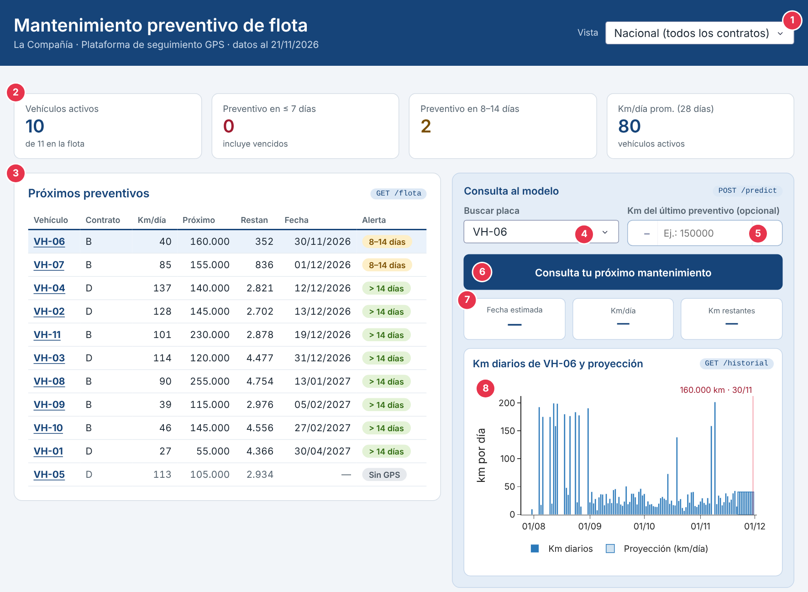
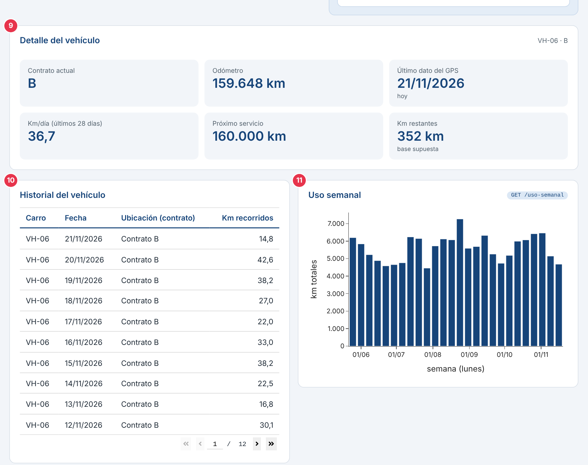
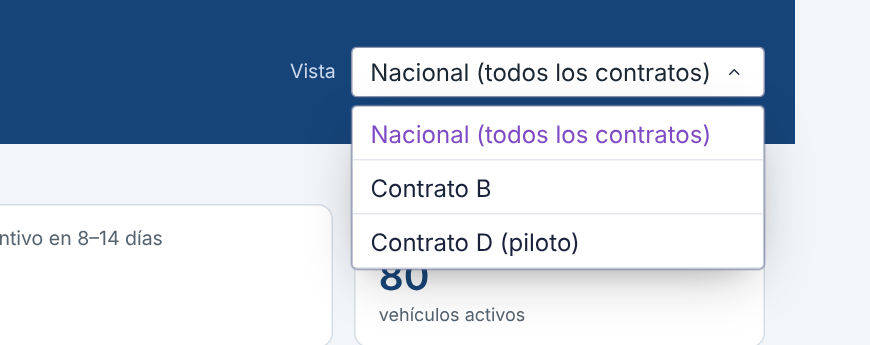
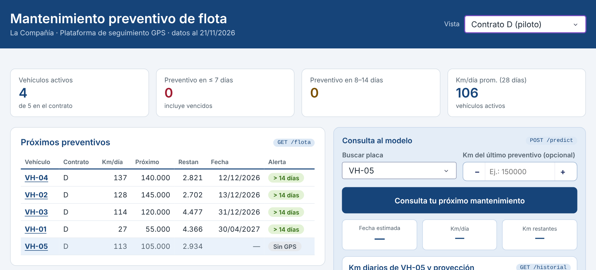
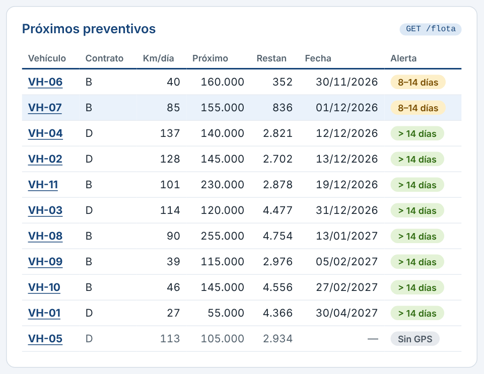
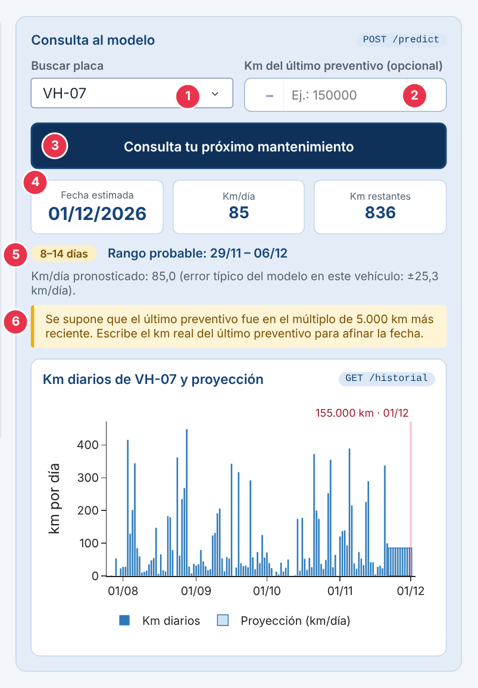
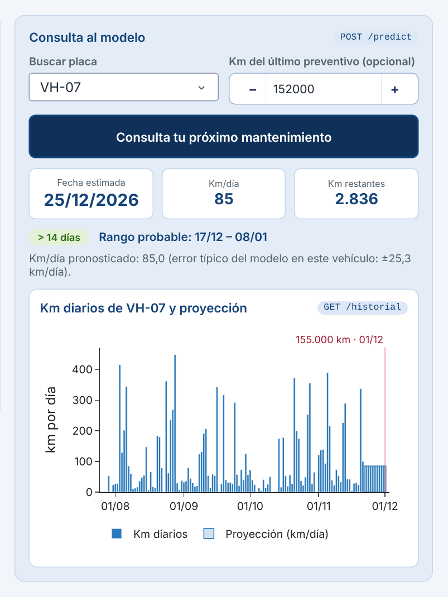
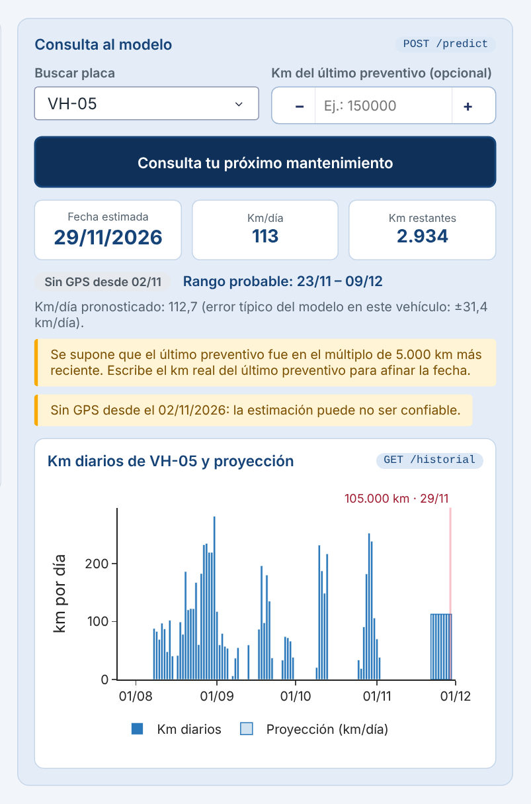
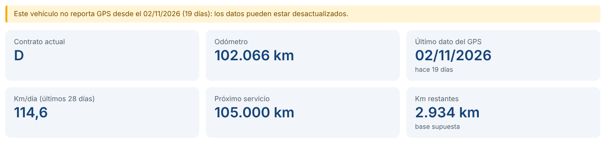
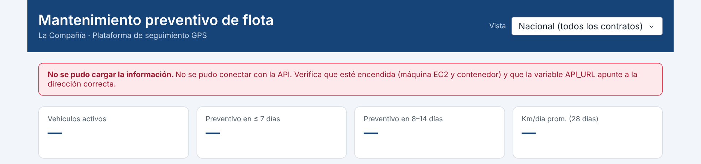

# Manual de usuario del tablero de mantenimiento preventivo de flota

Proyecto *Predicción de la fecha del próximo mantenimiento preventivo en la flota* · Despliegue de Soluciones Analíticas (MIAD)

Dirección del tablero: **https://flota-tablero.onrender.com/**

## 1. Para qué sirve

El tablero responde una pregunta: **¿cuándo le toca el próximo mantenimiento preventivo a cada vehículo de la flota?**

La Compañía hace el preventivo cada 5.000 km. El tablero consulta un modelo de aprendizaje automático, entrenado con el historial del GPS, que estima cuántos kilómetros por día recorrerá cada vehículo. Con ese ritmo calcula la fecha en la que el vehículo alcanzará el siguiente múltiplo de 5.000 km. Así se puede planificar con anticipación: ver qué vehículos van a necesitar taller primero y reservar el servicio.

Los datos están anonimizados: los vehículos aparecen como `VH-01` a `VH-11` y los contratos como Contrato B y Contrato D.

## 2. Cómo ingresar

1. Abra la dirección del tablero en un navegador (Chrome, Edge o Firefox) desde un computador o un celular.
2. No se necesita usuario ni contraseña.
3. Si el tablero lleva un rato sin usarse, la primera carga puede tardar **hasta un minuto**, porque el servicio gratuito se suspende por inactividad. Espere a que aparezcan los datos y no recargue varias veces.

El tablero es de **solo consulta**: no modifica datos ni registra mantenimientos.

## 3. Recorrido por la pantalla

*Figura 1. Parte superior del tablero (elementos 1 a 8).*

| N.º | Elemento | Qué muestra o para qué sirve |
|---|---|---|
| 1 | **Vista** | Cambia entre **Nacional** (toda la flota) y un contrato (B o D). Todo el tablero se actualiza con la vista elegida. |
| 2 | **Indicadores** | Vehículos activos (los que reportaron GPS en los últimos 7 días), vehículos con preventivo en 7 días o menos (incluye los vencidos), vehículos con preventivo en 8 a 14 días, y kilómetros por día promedio de los últimos 28 días. |
| 3 | **Próximos preventivos** | Tabla de la flota ordenada por la fecha más cercana. Al hacer clic en una placa se elige ese vehículo. |
| 4 | **Buscar placa** | Lista de vehículos de la vista elegida. Se puede escribir parte de la placa para filtrarla. |
| 5 | **Km del último preventivo (opcional)** | Permite indicar el kilometraje real del último preventivo para afinar la fecha. |
| 6 | **Botón «Consulta tu próximo mantenimiento»** | Pide al modelo la estimación del vehículo elegido. |
| 7 | **Resultado de la consulta** | Fecha estimada, kilómetros por día pronosticados y kilómetros restantes para el próximo servicio. |
| 8 | **Km diarios y proyección** | Gráfica del uso reciente del vehículo y de la proyección hasta la fecha estimada. |

*Figura 2. Parte inferior del tablero (elementos 9 a 11).*

| N.º | Elemento | Qué muestra o para qué sirve |
|---|---|---|
| 9 | **Detalle del vehículo** | Contrato actual, odómetro, fecha del último dato del GPS, kilómetros por día de los últimos 28 días, próximo servicio y kilómetros restantes. |
| 10 | **Historial del vehículo** | Kilómetros recorridos por día, del más reciente al más antiguo, con 10 días por página. |
| 11 | **Uso semanal** | Kilómetros totales por semana (la semana empieza el lunes) de los vehículos de la vista elegida, de las últimas 26 semanas. |

Al final de la página, un texto pequeño indica la versión de los datos, el modelo y la versión de la API que se están usando.

## 4. Cómo hacer las tareas más comunes

### 4.1 Ver toda la flota o un contrato

1. En la parte superior derecha, abra la lista **Vista**.
2. Elija **Nacional (todos los contratos)**, **Contrato B** o **Contrato D (piloto)**.

*Figura 3. Selector de la vista.*

Los indicadores, la tabla, el uso semanal y la lista de placas cambian según la vista. Si el vehículo que estaba elegido no pertenece al contrato nuevo, el tablero elige automáticamente el primero de la tabla.

*Figura 4. Ejemplo con la vista del Contrato D (piloto).*

### 4.2 Saber qué vehículos necesitan mantenimiento pronto

Revise la tabla **Próximos preventivos**. Los vehículos con fecha más cercana aparecen arriba, y los que no reportan GPS aparecen al final.

*Figura 5. Tabla de próximos preventivos.*

| Columna | Significado |
|---|---|
| Vehículo | Placa anonimizada. Haga clic para elegirla. |
| Contrato | Contrato en el que opera el vehículo actualmente. |
| Km/día | Kilómetros por día que el modelo pronostica para los próximos 28 días. |
| Próximo | Kilometraje del próximo servicio (el siguiente múltiplo de 5.000 km). |
| Restan | Kilómetros que faltan para ese servicio. |
| Fecha | Fecha estimada en la que se alcanzará el kilometraje del próximo servicio. |
| Alerta | Urgencia del servicio. Ver la tabla siguiente. |

| Alerta | Color | Significado |
|---|---|---|
| **≤ 7 días** | Rojo | El preventivo se alcanzaría en una semana o menos. |
| **Vencido** | Rojo | El kilometraje del próximo servicio ya se superó. |
| **8–14 días** | Amarillo | El preventivo se alcanzaría entre 8 y 14 días. |
| **> 14 días** | Verde | El preventivo está a más de dos semanas. |
| **Sin GPS** | Gris | El vehículo lleva más de 7 días sin reportar. No se muestra fecha en la tabla. |

Las alertas siempre llevan texto además del color.

### 4.3 Consultar la fecha del próximo mantenimiento de un vehículo

1. En **Buscar placa**, elija el vehículo (o haga clic en su placa en la tabla). Puede escribir parte de la placa para filtrar la lista.
2. Pulse **Consulta tu próximo mantenimiento**.
3. Lea el resultado en el bloque sombreado.

*Figura 6. Consulta del vehículo VH-07 (elementos 1 a 6 explicados abajo).*

| N.º | Qué muestra |
|---|---|
| 1 | Vehículo elegido. |
| 2 | Campo opcional del kilometraje del último preventivo (ver 4.4). |
| 3 | Botón de consulta. |
| 4 | **Fecha estimada**, **Km/día** pronosticados y **Km restantes** hasta el próximo servicio. |
| 5 | La alerta del vehículo y el **rango probable** de fechas. |
| 6 | Avisos que explican en qué se basa la estimación. |

Debajo del resultado se muestra el km por día pronosticado y el **error típico del modelo** en ese vehículo, expresado en km/día. Si cambia de vehículo, el resultado anterior se borra para que no se confunda con el nuevo.

### 4.4 Afinar la fecha con el kilometraje del último preventivo

Si no se indica nada, el tablero supone que el último preventivo se hizo en el múltiplo de 5.000 km más reciente (por eso aparece el aviso amarillo de la Figura 6). Si el último preventivo se hizo en otro kilometraje, la fecha cambia:

1. Elija el vehículo.
2. Escriba en **Km del último preventivo (opcional)** el kilometraje al que se hizo (por ejemplo, `152000`), sin puntos ni espacios.
3. Pulse **Consulta tu próximo mantenimiento**.

*Figura 7. VH-07 con último preventivo en 152.000 km: el próximo servicio pasa a 157.000 km, y la fecha estimada pasa del 01/12/2026 al 25/12/2026.*

El aviso amarillo desaparece, porque ya no se está suponiendo el dato.

### 4.5 Revisar el uso reciente y la proyección

La gráfica **Km diarios y proyección** (elemento 8 de la Figura 1) muestra:

- **Barras azules:** kilómetros recorridos cada día en los últimos 120 días. Los huecos son días sin registro.
- **Barras claras con borde:** el km por día pronosticado, repetido desde el último dato hasta la fecha estimada (hasta 60 días).
- **Línea roja:** la fecha estimada, con el kilometraje del próximo servicio y la fecha. Si la fecha está muy lejos, la línea queda al borde y la etiqueta dice «fuera del rango».

### 4.6 Consultar el historial y el uso semanal

- **Historial del vehículo** (elemento 10): muestra los kilómetros de cada día del vehículo elegido, del más reciente al más antiguo. Use las flechas de abajo para pasar de página. «Sin dato» significa que ese día no hay registro de kilómetros. Los días de traslado entre contratos aparecen como «Traslado».
- **Uso semanal** (elemento 11): suma de kilómetros por semana de todos los vehículos de la vista elegida. Sirve para ver si la flota está trabajando más o menos que de costumbre.

## 5. Cómo interpretar los resultados

- **La fecha estimada es una estimación, no una cita de taller.** Se calcula sumando, a la fecha del último dato del GPS, los días que tardaría el vehículo en recorrer los kilómetros que le faltan al ritmo pronosticado.
- **Use el rango probable, no solo la fecha.** El rango se calcula con el error típico del modelo en ese vehículo. Un rango ancho significa más incertidumbre: conviene dejar más margen al planificar.
- **Los kilómetros por día de la tabla y del resultado son pronósticos**, y los de «Detalle del vehículo» son el promedio real de los últimos 28 días. Pueden diferir si el vehículo está cambiando su ritmo de uso.
- **Km restantes con «base supuesta»** indica que el cálculo supone que el último preventivo fue en el múltiplo de 5.000 km más reciente.

### Vehículos sin GPS reciente

Si un vehículo lleva más de 7 días sin reportar, aparece como **Sin GPS** en la tabla, no cuenta como activo en los indicadores y el tablero muestra un aviso amarillo en el detalle y en la consulta. En ese caso, la fecha de la consulta es solo **referencial**, porque parte de datos antiguos.

*Figura 8. Consulta de VH-05, que no reporta GPS desde el 02/11/2026.*

*Figura 9. Aviso en «Detalle del vehículo» para un vehículo sin GPS.*

## 6. Mensajes y problemas frecuentes

| Qué ve | Qué significa | Qué hacer |
|---|---|---|
| La página tarda en mostrar datos al abrirla. | El servicio estaba suspendido por inactividad. | Espere hasta un minuto. |
| Recuadro rojo: **«No se pudo cargar la información. No se pudo conectar con la API…»** | La API que calcula las estimaciones está apagada o no se puede alcanzar. | Avise a la persona responsable del despliegue y vuelva a intentarlo más tarde. |
| Texto rojo en la consulta: **«Elige primero un vehículo.»** | No hay vehículo elegido. | Elija una placa en **Buscar placa**. |
| Texto rojo: **«El kilometraje del último preventivo no puede ser negativo.»** | Se escribió un valor menor que cero. | Escriba un número positivo o deje el campo vacío. |
| Texto rojo con un mensaje de la API (por ejemplo, que no existe el vehículo). | La API no reconoció la solicitud. | Use una placa de la lista. |
| Aviso amarillo: **«Se supone que el último preventivo fue en el múltiplo de 5.000 km…»** | No se indicó el kilometraje del último preventivo. | Es normal. Escriba el dato real para afinar la fecha (4.4). |
| Aviso amarillo: **«Sin GPS desde…»** | El vehículo no reporta hace más de 7 días. | Tome la fecha como referencia y verifique el equipo de GPS. |
| Alerta **Vencido** | El kilometraje del próximo servicio ya se superó. | Programe el preventivo cuanto antes. |
| **Sin dato** en el historial | Ese día no hay kilómetros registrados. | No requiere acción. |

*Figura 10. Aviso que aparece cuando el tablero no logra comunicarse con la API.*

## 7. Alcance y limitaciones

- La estimación se basa en el **uso reciente** de cada vehículo. No considera el estado mecánico, paradas por taller, cambios de ruta ni traslados futuros entre contratos.
- Se asume un preventivo **cada 5.000 km**. Si no se informa el kilometraje del último preventivo, se supone que fue en el múltiplo de 5.000 km más reciente.
- Los datos llegan hasta la fecha que muestra el subtítulo de la página («datos al …»). El tablero no se actualiza en tiempo real.
- El historial muestra fecha, contrato y kilómetros por día. No incluye viajes ni nombres de conductores, porque los datos están anonimizados.
- El modelo y los datos viven en la API, fuera del tablero. El texto al final de la página indica cuál modelo y cuál versión de los datos se están usando.
