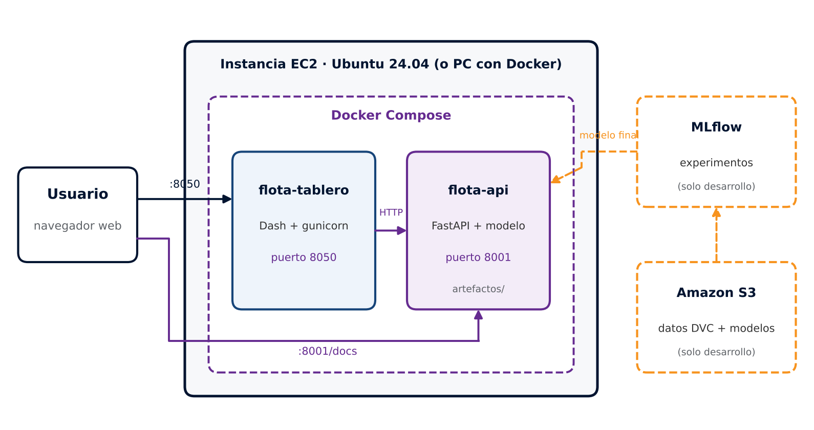
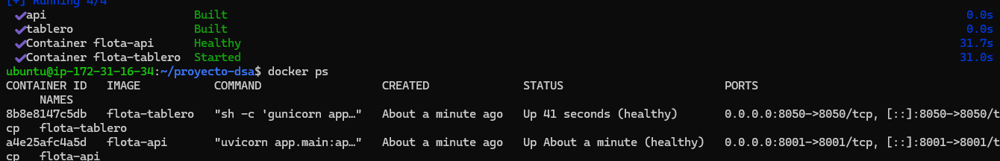
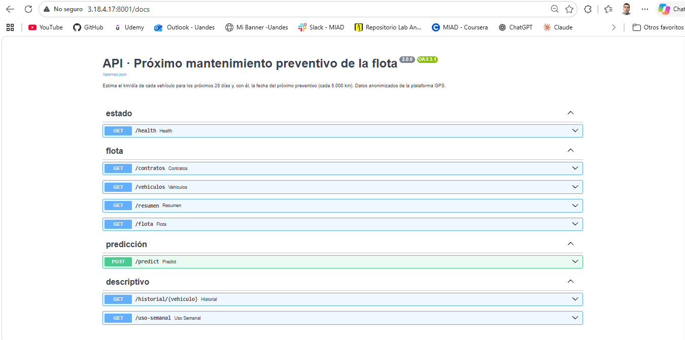
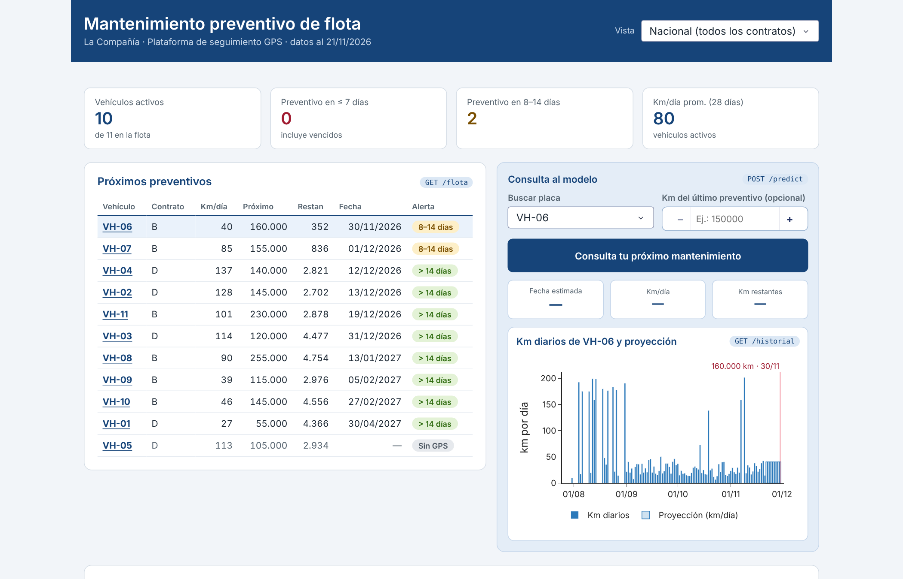

# Manual de instalación

**Tablero de predicción del próximo mantenimiento preventivo de la flota**

Despliegue de Soluciones Analíticas · Maestría en Inteligencia Analítica de Datos (MIAD) · Universidad de los Andes  
Equipo: Guido Alejandro Jácome Hernández, Ana Sofía Bermúdez Moreno, Alejandro Acosta, Gabriela Rivera · noviembre de 2026

> Versión para descargar (PDF): [Manual_de_instalacion.pdf](../downloads/Manual_de_instalacion.pdf)

## 1. Introducción

Este manual explica cómo instalar y poner en marcha el tablero de predicción del próximo mantenimiento preventivo de la flota de camionetas, junto con sus dependencias: la API que sirve el modelo y el propio modelo entrenado. Está pensado para que una persona que no conoce el proyecto pueda reproducir el despliegue siguiendo los pasos en orden.

La solución completa se levanta con **un solo comando de Docker Compose**. El manual cubre dos escenarios:

- **Despliegue en la nube (recomendado):** una máquina virtual EC2 de AWS, que es como está publicado el prototipo.
- **Ejecución local:** en un computador con Docker Desktop (Windows, macOS o Linux), útil para revisar o probar la solución.

| Componente | Tecnología | Puerto | Función |
| --- | --- | --- | --- |
| Tablero | Dash + gunicorn (Python 3.12) | 8050 | Interfaz para el usuario: flota, alertas, consulta al modelo y gráficas |
| API | FastAPI + uvicorn (Python 3.11) | 8001 | Sirve las predicciones del modelo y los datos que muestra el tablero |
| Modelo | SVR (scikit-learn), registrado en MLflow como svr_8 | — | Pronostica el km/día de los próximos 28 días; viaja dentro de la imagen de la API |

## 2. Arquitectura de la solución

El tablero no tiene datos ni modelo propios: todo lo consulta a la API por HTTP. Los dos servicios corren en contenedores Docker orquestados con `docker-compose.yml` y se comunican por la red interna de Docker (el tablero llama a la API como `http://api:8001`). El tablero solo arranca cuando la API responde sana.



*Figura 1. Arquitectura de despliegue. En línea punteada naranja, los servicios usados solo durante el desarrollo.*

MLflow y Amazon S3 se usaron para registrar los experimentos y versionar los datos (DVC). **No son necesarios para instalar el tablero**: el modelo final y los datos anonimizados que usa la API ya están en el repositorio, en `api/artefactos/`.

## 3. Qué incluye el repositorio

Repositorio público: `github.com/gabriela-rivera/proyecto-dsa` (rama `main`). Para instalar el tablero se usan solo estas carpetas:

| Ruta | Contenido |
| --- | --- |
| `docker-compose.yml` | Define los dos servicios (api y tablero), sus puertos y el orden de arranque |
| `api/` | Código de la API (app/), Dockerfile, pruebas automáticas (tests/) y artefactos/ |
| `api/artefactos/` | modelo.joblib (modelo final), panel.csv (datos diarios anonimizados) y metadatos.json |
| `tablero/` | Código del tablero (app.py, api.py, config.py), estilos (assets/) y Dockerfile |

> [!NOTE]
> **Lo que no se necesita:** las credenciales de AWS, el acceso al servidor de MLflow ni `dvc pull`. El remoto de datos (S3) es privado porque los datos crudos pertenecen a la Compañía; el tablero funciona con los artefactos anonimizados incluidos en el repositorio.

## 4. Requisitos previos

### 4.1 Para el despliegue en AWS

| Recurso | Valor usado en el proyecto | Mínimo recomendado |
| --- | --- | --- |
| Cuenta de AWS | Cuenta propia del equipo (región us-east-2, Ohio) | Cualquier región |
| Instancia EC2 | t3.small · Ubuntu Server 24.04 LTS | 2 GB de RAM (t3.small) |
| Disco | 20 GB gp3 | 15 GB |
| IP pública | IP elástica 3.18.4.17 | Recomendada (no cambia al reiniciar) |
| Par de llaves | Archivo .pem para conectarse por SSH | Obligatorio |
| Puertos de entrada | 22 (SSH), 8001 (API), 8050 (tablero) | Los mismos |

> [!WARNING]
> **Memoria:** con 1 GB de RAM (t2.micro o t3.micro) la construcción de las imágenes puede fallar por falta de memoria. Use t3.small o agregue memoria de intercambio (sección 9).

### 4.2 Para la ejecución local

- **Docker Desktop** (Windows o macOS) o Docker Engine con el complemento Compose (Linux).
- **Git** para clonar el repositorio (o descargar el ZIP desde GitHub).
- Puertos 8001 y 8050 libres en el computador.

## 5. Instalación en AWS (EC2)

### 5.1 Crear la instancia

1. En la consola de AWS, vaya a **EC2 → Instancias → Lanzar instancia**.
2. **Nombre:** por ejemplo `dsa-proyecto-flota`. **Imagen:** Ubuntu Server 24.04 LTS. **Tipo:** t3.small.
3. **Par de llaves:** cree uno nuevo (formato .pem) y guárdelo en un lugar seguro de su computador.
4. **Almacenamiento:** 20 GB.
5. **Lanzar instancia**. Opcional, pero recomendado: en **Direcciones IP elásticas**, asigne una IP y asóciela a la instancia para que la dirección no cambie.

### 5.2 Abrir los puertos (grupo de seguridad)

En la instancia → pestaña **Seguridad** → grupo de seguridad → **Editar reglas de entrada**, y deje estas reglas:

| Tipo | Puerto | Origen | Uso |
| --- | --- | --- | --- |
| SSH | 22 | Mi IP (o 0.0.0.0/0) | Conexión remota para instalar |
| TCP personalizado | 8001 | 0.0.0.0/0 | API y su documentación (/docs) |
| TCP personalizado | 8050 | 0.0.0.0/0 | Tablero |

### 5.3 Conectarse por SSH

Desde PowerShell (Windows) o la terminal (macOS/Linux), en la carpeta donde guardó la llave. Reemplace `<IP>` por la IP pública de su instancia:

```bash
ssh -o ServerAliveInterval=60 -i "mi-llave.pem" ubuntu@<IP>
```

> [!NOTE]
> Si Windows indica que la llave tiene permisos demasiado abiertos, restrínjalos con: `icacls "mi-llave.pem" /inheritance:r /grant:r "%USERNAME%:R"`. En macOS o Linux: `chmod 400 mi-llave.pem`.

### 5.4 Instalar Docker

Ya dentro de la instancia, ejecute:

```bash
sudo apt-get update
sudo apt-get install -y docker.io docker-compose-v2 git
sudo usermod -aG docker ubuntu
```

El último comando permite usar Docker sin `sudo`. Para que tenga efecto, **cierre la sesión con exit y vuelva a conectarse** con el mismo comando ssh. Luego verifique:

```bash
docker --version
docker compose version
docker ps
```

Los tres deben responder sin errores (`docker ps` muestra una tabla vacía).

### 5.5 Descargar el proyecto y levantar los servicios

```bash
git clone https://github.com/gabriela-rivera/proyecto-dsa.git
cd proyecto-dsa
docker compose up -d --build
```

La primera vez tarda entre 2 y 4 minutos: Docker descarga las imágenes base de Python e instala las librerías. Al final debe ver `Container flota-api Healthy` y `Container flota-tablero Started`.

> [!NOTE]
> **Orden de arranque:** el tablero espera a que la API pase su chequeo de salud (`depends_on: condition: service_healthy`), por eso arranca unos segundos después. Ambos contenedores tienen `restart: always`: si la instancia se reinicia, vuelven a subir solos.

## 6. Verificación

1. Compruebe que los dos contenedores estén arriba y sanos:

```bash
docker ps
```



*Figura 2. Los dos contenedores en estado healthy, con los puertos 8001 y 8050 publicados.*

2. Compruebe la API desde la misma máquina. Debe responder con `"estado":"ok"`, el nombre del modelo y la versión de los datos:

```bash
curl -s http://localhost:8001/health
```

3. Desde su navegador, abra la documentación interactiva de la API en `http://<IP>:8001/docs`. Allí puede probar cada servicio con el botón **Try it out**.



*Figura 3. Documentación interactiva de la API (FastAPI) con sus siete servicios.*

4. Abra el tablero en `http://<IP>:8050`. Debe ver los indicadores de la flota, la tabla de próximos preventivos y el bloque de consulta al modelo. El pie de página muestra el modelo y la versión de los datos en uso.



*Figura 4. Tablero desplegado consultando la API (vista nacional).*

| Servicio de la API | Qué devuelve | Dónde se usa en el tablero |
| --- | --- | --- |
| `GET /health` | Estado, modelo y versión de datos | Pie de página |
| `GET /contratos` | Contratos y número de vehículos | Selector de vista |
| `GET /resumen` | Indicadores de la flota o del contrato | Tarjetas superiores |
| `GET /flota` | Fecha estimada y alerta por vehículo | Tabla de próximos preventivos |
| `POST /predict` | Predicción para un vehículo (km del último preventivo opcional) | Consulta al modelo |
| `GET /historial/{vehiculo}` | Km diarios recientes y proyección | Gráfica e historial |
| `GET /uso-semanal` | Km por semana y vehículo | Gráfica de uso semanal |

## 7. Ejecución local

### 7.1 Con Docker (recomendado)

Con Docker Desktop abierto, en una terminal:

```bash
git clone https://github.com/gabriela-rivera/proyecto-dsa.git
cd proyecto-dsa
docker compose up -d --build
```

Abra `http://localhost:8050` (tablero) y `http://localhost:8001/docs` (API). Para detener todo: `docker compose down`.

### 7.2 Sin Docker (para desarrollo)

Requiere Python 3.11 o superior. Use dos terminales, ambas desde la raíz del repositorio:

#### Terminal 1: API

```bash
python -m venv .venv
.venv\Scripts\activate          # en macOS/Linux: source .venv/bin/activate
pip install -r api/requirements-test.txt
cd api
python -m pytest                  # 17 pruebas deben pasar
uvicorn app.main:app --port 8001
```

#### Terminal 2: tablero

```bash
.venv\Scripts\activate
pip install -r tablero/requirements.txt
$env:API_URL = "http://localhost:8001"   # en macOS/Linux: export API_URL=http://localhost:8001
python tablero/app.py
```

El tablero queda en `http://127.0.0.1:8050`. La variable `API_URL` indica dónde está la API; si no se define, el tablero usa la API publicada en la nube.

## 8. Configuración

| Variable | Servicio | Valor por defecto | Para qué sirve |
| --- | --- | --- | --- |
| `API_URL` | Tablero | http://api:8001 (Docker) | Dirección de la API que consulta el tablero |
| `API_TIMEOUT` | Tablero | 10 | Segundos de espera por respuesta de la API |
| `PORT` | Tablero | 8050 | Puerto en el que escucha el tablero |
| `ARTEFACTOS_DIR` | API | api/artefactos | Carpeta con el modelo, el panel y los metadatos |

Las reglas del negocio (intervalo de 5.000 km entre preventivos, alertas a 7 y 14 días, 7 días sin GPS para marcar un vehículo como inactivo) están en `api/app/config.py`.

## 9. Operación y solución de problemas

### 9.1 Comandos de uso diario

| Acción | Comando |
| --- | --- |
| Ver el estado de los contenedores | `docker ps` |
| Ver los registros de la API o del tablero | `docker logs --tail 50 flota-api`  ·  `docker logs --tail 50 flota-tablero` |
| Reiniciar los servicios | `docker compose restart` |
| Detener los servicios | `docker compose down` |
| Actualizar a la última versión del repositorio | `git pull`  y luego  `docker compose up -d --build` |

> [!WARNING]
> **Costos en AWS:** una instancia encendida cobra por hora. Cuando no se use, deténgala desde la consola (**Estado de la instancia → Detener**); no la termine, porque se pierde. Al encenderla de nuevo, los contenedores arrancan solos.

### 9.2 Problemas frecuentes

| Síntoma | Causa probable | Solución |
| --- | --- | --- |
| El navegador no abre :8050 o :8001 | Puerto cerrado en el grupo de seguridad, o se usa una IP que cambió | Revise las reglas de entrada (5.2) y la IP pública actual de la instancia |
| `permission denied` al usar docker | El usuario aún no pertenece al grupo docker | Salga con exit y vuelva a conectarse por SSH (5.4) |
| La construcción se detiene o la instancia se congela | Falta de memoria (instancias de 1 GB) | Cambie a t3.small o agregue 2 GB de memoria de intercambio: `sudo fallocate -l 2G /swapfile && sudo chmod 600 /swapfile && sudo mkswap /swapfile && sudo swapon /swapfile` |
| `port is already allocated` | Otro programa usa el puerto 8001 u 8050 | Identifíquelo con `sudo ss -ltnp \| grep 8050` y deténgalo |
| flota-tablero no arranca | Espera a que la API esté sana | Revise `docker logs flota-api`; cuando la API esté healthy, el tablero sube solo |
| El tablero muestra «No se pudo conectar con la API» | API detenida o API_URL incorrecta | Verifique `docker ps` y la variable API_URL (sección 8) |

## 10. Actualizar el modelo o los datos

Esta sección es para el equipo de desarrollo, que tiene acceso a MLflow y al remoto de datos. No es necesaria para instalar el tablero.

1. Descargue los datos versionados: `dvc pull` (requiere credenciales del bucket S3).
2. Si cambian los datos crudos, regenérelos: `python src/pipeline_anonimizar_reporte.py` y `python src/pipeline_preprocesamiento.py`.
3. Entrene y registre los modelos en MLflow con los notebooks de `notebooks/` y escoja el mejor por validación cruzada.
4. Genere los artefactos de la API con el modelo escogido, tomado directamente de MLflow:

```bash
python api/preparar_artefactos.py --run-id <RUN_ID>
cd api && python -m pytest
```

5. Suba los cambios al repositorio (rama → pull request → development → main) y, en la instancia: `git pull` y `docker compose up -d --build`.

## Anexo. Infraestructura de desarrollo

Como referencia, estos son los recursos que el equipo usó durante el desarrollo y que aparecen en el reporte y en el video:

| Recurso | Configuración |
| --- | --- |
| Servidor MLflow | En la misma instancia EC2, puerto 5000, con usuario y contraseña (autenticación básica de MLflow), registro en SQLite y artefactos en S3; servicio de Linux con reinicio automático |
| Bucket S3 | miad-dsa-flota-dvc (privado, cifrado SSE-S3): remoto de DVC para los datos versionados (etiquetas datos-v1 y datos-v2) y almacén de los modelos de MLflow |
| Acceso a S3 | Usuarios IAM por integrante con una política limitada al bucket (sin permiso de borrado); la instancia accede mediante un rol de IAM, sin llaves guardadas en el servidor |
| Datos | Reporte diario de movimiento de la plataforma de seguimiento GPS, anonimizado según la tabla de anonimización del proyecto antes de versionarlo |
