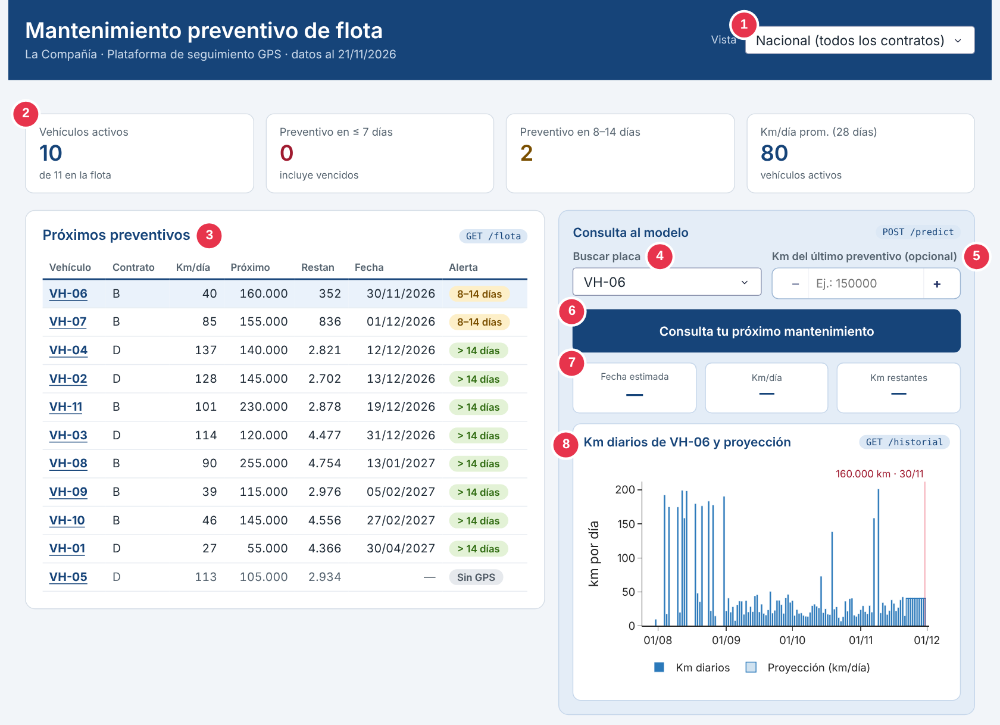
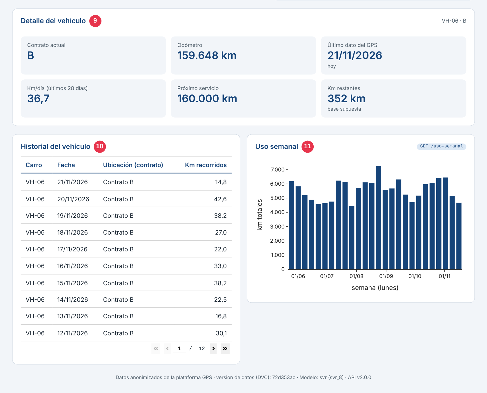
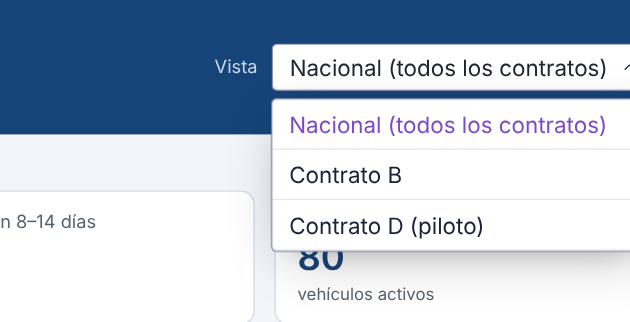
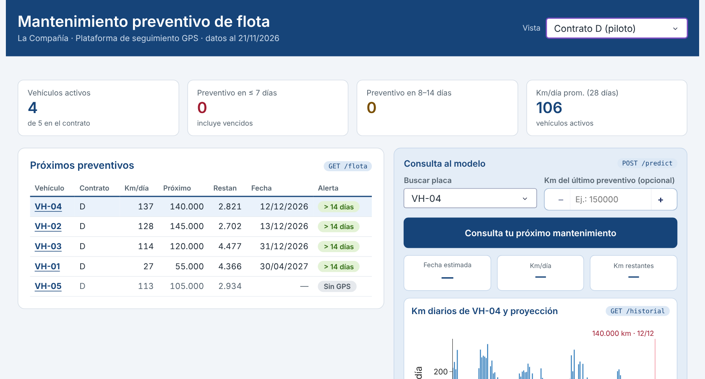
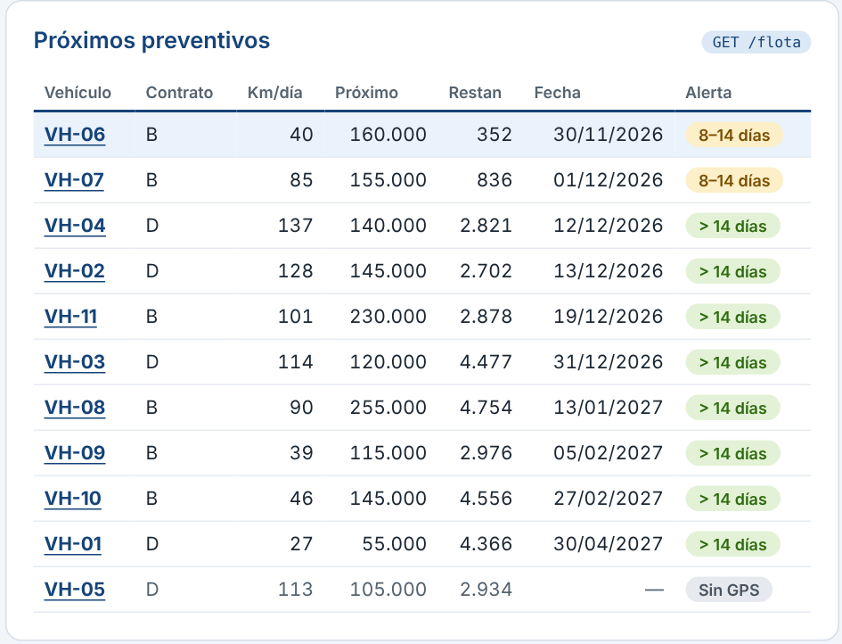
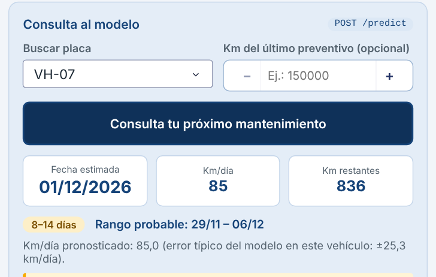
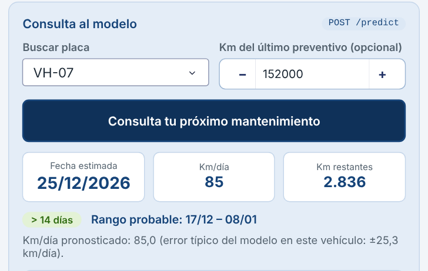
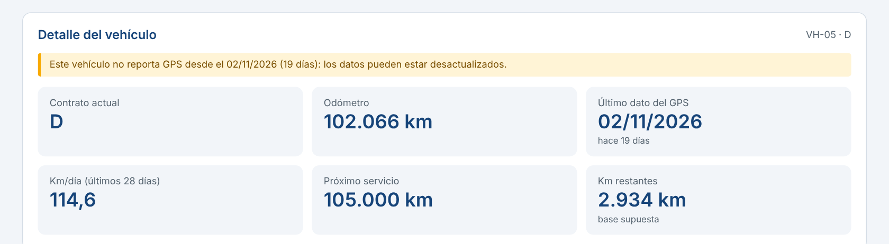
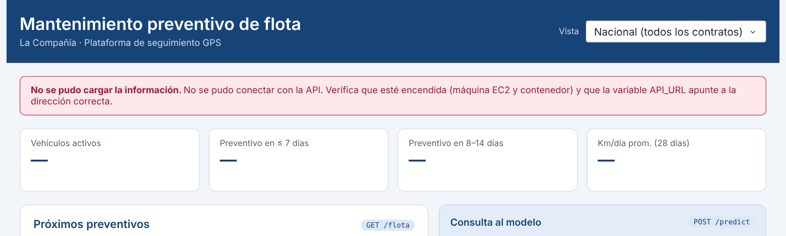

# Manual de usuario

**Tablero de predicción del próximo mantenimiento preventivo de la flota**

Despliegue de Soluciones Analíticas · Maestría en Inteligencia Analítica de Datos (MIAD) · Universidad de los Andes  
Equipo: Guido Alejandro Jácome Hernández, Ana Sofía Bermúdez Moreno, Alejandro Acosta, Gabriela Rivera · noviembre de 2026

> Versión para descargar (PDF): [Manual_de_usuario.pdf](../downloads/Manual_de_usuario.pdf)

## 1. Propósito del tablero

El tablero responde una pregunta concreta para el área de mantenimiento: **¿cuándo le toca el próximo mantenimiento preventivo a cada vehículo de la flota?**

La Compañía realiza el mantenimiento preventivo de sus camionetas cada 5.000 km. El tablero consulta un modelo de aprendizaje automático que, a partir del historial del GPS, pronostica cuántos kilómetros por día recorrerá cada vehículo en las próximas cuatro semanas. Con ese ritmo calcula la fecha en la que el vehículo alcanzará el kilometraje de su próximo servicio.

Con esta información el coordinador de mantenimiento puede:

- ver de un vistazo qué vehículos necesitan taller primero;
- programar los servicios y reservar cupo en el taller con anticipación;
- detectar vehículos que dejaron de reportar GPS y cuya información puede estar desactualizada.

> [!NOTE]
> **Datos anonimizados.** Los vehículos aparecen como VH-01 a VH-11 y los contratos con letras (Contrato B y Contrato D). El tablero es de solo consulta: no modifica datos ni registra mantenimientos.

## 2. Cómo ingresar

1. Abra en un navegador (Chrome, Edge o Firefox) la dirección del tablero: `http://3.18.4.17:8050`.
2. No se necesita usuario ni contraseña.
3. Espere unos segundos a que carguen los datos. En la parte superior aparece la fecha de los datos (por ejemplo, **datos al 21/11/2026**).

El tablero también se puede abrir desde un celular, aunque se ve mejor en un computador.

## 3. Recorrido por la pantalla

La pantalla está organizada de arriba hacia abajo: primero el resumen de la flota, luego la consulta de un vehículo y al final su detalle e historial. Los números rojos de las figuras corresponden a las tablas de esta sección.

*Figura 1. Parte superior del tablero (elementos 1 a 8).*

| N.º | Elemento | Qué muestra o para qué sirve |
| --- | --- | --- |
| 1 | Vista | Cambia entre la flota completa (Nacional) y un contrato. Todo el tablero se actualiza con la vista elegida. |
| 2 | Indicadores | Vehículos activos, vehículos con preventivo en 7 días o menos (incluye vencidos), vehículos con preventivo en 8 a 14 días y kilómetros por día promedio de los últimos 28 días. |
| 3 | Próximos preventivos | Tabla de la flota ordenada por la fecha más cercana, con la alerta de cada vehículo. Al hacer clic en una placa, se selecciona ese vehículo. |
| 4 | Buscar placa | Lista de los vehículos de la vista elegida. Se puede escribir parte de la placa para filtrar. |
| 5 | Km del último preventivo | Campo opcional para indicar el kilometraje real del último preventivo y afinar la fecha. |
| 6 | Botón de consulta | «Consulta tu próximo mantenimiento»: pide al modelo la estimación del vehículo seleccionado. |
| 7 | Resultado | Fecha estimada, kilómetros por día pronosticados y kilómetros que faltan para el próximo servicio. |
| 8 | Km diarios y proyección | Uso diario reciente del vehículo y la proyección hasta la fecha estimada. |

*Figura 2. Parte inferior del tablero (elementos 9 a 11).*

| N.º | Elemento | Qué muestra o para qué sirve |
| --- | --- | --- |
| 9 | Detalle del vehículo | Contrato actual, odómetro, fecha del último dato del GPS, km por día de los últimos 28 días, próximo servicio y kilómetros restantes. |
| 10 | Historial del vehículo | Kilómetros recorridos por día y contrato en el que operó, del más reciente al más antiguo (10 días por página). |
| 11 | Uso semanal | Kilómetros totales por semana de los vehículos de la vista elegida en las últimas 26 semanas (la semana empieza el lunes). |

Al final de la página, un texto pequeño indica la versión de los datos, el modelo en uso (**svr (svr_8)**) y la versión de la API.

## 4. Tareas frecuentes

### 4.1 Ver la flota completa o un contrato

1. En la esquina superior derecha, abra la lista **Vista**.
2. Elija **Nacional (todos los contratos)**, **Contrato B** o **Contrato D (piloto)**.

*Figura 3. Selector de la vista.*

Los indicadores, la tabla de próximos preventivos, el uso semanal y la lista de placas cambian según la vista. Si el vehículo seleccionado no pertenece al contrato elegido, el tablero selecciona el primero de la tabla.

*Figura 4. Vista del Contrato D (piloto): 5 vehículos, 4 de ellos activos.*

### 4.2 Identificar qué vehículos necesitan mantenimiento pronto

Revise la tabla Próximos preventivos. Los vehículos con la fecha más cercana aparecen arriba; los que no reportan GPS aparecen al final.

*Figura 5. Tabla de próximos preventivos con sus alertas.*

| Columna | Significado |
| --- | --- |
| Vehículo | Placa anonimizada. Haga clic para seleccionarlo. |
| Contrato | Contrato en el que opera actualmente. |
| Km/día | Kilómetros por día que el modelo pronostica para los próximos 28 días. |
| Próximo | Kilometraje del próximo servicio (el siguiente múltiplo de 5.000 km). |
| Restan | Kilómetros que faltan para ese servicio. |
| Fecha | Fecha estimada en la que el vehículo alcanzará el kilometraje del próximo servicio. |
| Alerta | Urgencia del servicio (ver la tabla siguiente). |

| Alerta | Significado | Qué hacer |
| --- | --- | --- |
|  **≤ 7 días**  | El preventivo se alcanzaría en una semana o menos. | Programar el servicio de inmediato. |
|  **Vencido**  | El vehículo ya superó el kilometraje del próximo servicio. | Enviar a taller lo antes posible. |
|  **8–14 días**  | El preventivo se alcanzaría en las próximas dos semanas. | Reservar cupo en el taller. |
|  **> 14 días**  | El preventivo está a más de dos semanas. | Sin acción por ahora. |
|  **Sin GPS**  | El vehículo lleva más de 7 días sin reportar; no se muestra fecha. | Verificar con el contrato si el vehículo está en taller, detenido o con falla del GPS. |

### 4.3 Consultar la fecha del próximo mantenimiento de un vehículo

1. En **Buscar placa** elija el vehículo, o haga clic en su placa en la tabla.
2. Pulse **Consulta tu próximo mantenimiento**.
3. Lea el resultado en el bloque sombreado.

*Figura 6. Consulta del vehículo VH-07 sin indicar el último preventivo.*

El resultado incluye:

- **Fecha estimada** del próximo preventivo (en el ejemplo, 01/12/2026).
- **Km/día** que el modelo pronostica y **Km restantes** hasta el próximo servicio.
- **Alerta** y **rango probable** de fechas, calculado con el error típico del modelo para ese vehículo (en el ejemplo, ±25,3 km/día).
- Un aviso amarillo cuando la fecha se calcula con el último preventivo supuesto (ver 4.4).

### 4.4 Afinar la fecha con el kilometraje real del último preventivo

Si no se indica nada, el tablero supone que el último preventivo se hizo en el múltiplo de 5.000 km más reciente. Si se conoce el kilometraje real, la estimación es más precisa:

1. Seleccione el vehículo.
2. Escriba en **Km del último preventivo (opcional)** el kilometraje del último servicio, sin puntos ni espacios (por ejemplo, `152000`). También puede usar los botones − y +.
3. Pulse **Consulta tu próximo mantenimiento**.

*Figura 7. VH-07 con el último preventivo en 152.000 km.*

En el ejemplo, el próximo servicio pasa a 157.000 km, los kilómetros restantes a 2.836 y la fecha estimada del 01/12/2026 al 25/12/2026. El aviso amarillo desaparece porque ya no se está suponiendo el dato.

### 4.5 Revisar el uso reciente y la proyección

La gráfica Km diarios y proyección (elemento 8) muestra:

- **Barras azules:** kilómetros recorridos cada día en los últimos 120 días. Los huecos son días sin registro.
- **Barras claras:** el km por día pronosticado, desde el último dato hasta la fecha estimada (máximo 60 días).
- **Línea roja:** la fecha estimada, con el kilometraje del próximo servicio.

### 4.6 Consultar el detalle, el historial y el uso semanal

- **Detalle del vehículo** (elemento 9): datos actuales del vehículo seleccionado. «Base supuesta» bajo los km restantes indica que se supuso el último preventivo.
- **Historial del vehículo** (elemento 10): kilómetros de cada día y contrato en el que operó. Use las flechas para cambiar de página. «Traslado» indica días en que el vehículo se movió entre contratos.
- **Uso semanal** (elemento 11): suma de kilómetros por semana de los vehículos de la vista elegida; sirve para ver si la operación está más o menos activa que de costumbre.

## 5. Cómo interpretar los resultados

- **La fecha es una estimación, no una cita de taller.** Se calcula a partir de la fecha del último dato del GPS, sumando los días que el vehículo tardaría en recorrer los kilómetros que le faltan al ritmo pronosticado.
- **Planifique con el rango probable,** no solo con la fecha. Un rango amplio indica más incertidumbre y conviene dejar más margen.
- **Hay dos tipos de km/día:** los de la tabla y del resultado son el pronóstico del modelo; los del Detalle del vehículo son el promedio real de los últimos 28 días. Si difieren mucho, el vehículo está cambiando su ritmo de uso.
- **Indique el último preventivo siempre que lo conozca.** Si el vehículo no hizo el servicio exactamente en un múltiplo de 5.000 km, la fecha supuesta puede adelantarse o atrasarse varias semanas.
- **Fecha de los datos:** las estimaciones se basan en el GPS hasta la fecha que aparece en la parte superior. Un vehículo «Sin GPS» conserva su último odómetro conocido.

## 6. Mensajes y situaciones especiales

### 6.1 Vehículo sin GPS reciente

Cuando un vehículo lleva más de 7 días sin reportar, el tablero lo marca como «Sin GPS», lo ubica al final de la tabla y muestra un aviso en el detalle con la fecha del último reporte.

*Figura 8. Detalle de VH-05, que no reporta GPS desde el 02/11/2026.*

### 6.2 El tablero no carga la información

Si el servicio que hace las estimaciones (la API) no responde, el tablero no se cierra: muestra un recuadro rojo con el motivo y deja los indicadores vacíos.

*Figura 9. Mensaje cuando no hay conexión con la API.*

| Mensaje o situación | Qué hacer |
| --- | --- |
| «No se pudo conectar con la API» | Espere un momento y recargue la página. Si continúa, avise al administrador: la máquina de AWS o el contenedor de la API pueden estar apagados. |
| «La API no respondió en 10 segundos» | Vuelva a intentar en unos segundos. |
| El campo de km del último preventivo no acepta el valor | Escriba solo números, sin puntos ni espacios, y un valor mayor o igual a cero. |
| La fecha estimada parece muy lejana | El vehículo tiene muy poco uso reciente. Revise su historial y, si es posible, indique el km real del último preventivo. |

## 7. Glosario

| Término | Definición |
| --- | --- |
| Mantenimiento preventivo | Servicio programado que la Compañía realiza cada 5.000 km para evitar fallas. |
| Km/día pronosticado | Promedio de kilómetros por día que el modelo estima para los próximos 28 días. |
| Próximo servicio | Kilometraje en el que corresponde el siguiente preventivo. |
| Base supuesta | Indica que se asumió el último preventivo en el múltiplo de 5.000 km más reciente. |
| Rango probable | Intervalo de fechas que considera el error típico del modelo para el vehículo. |
| Vehículo activo | Vehículo que reportó datos de GPS en los últimos 7 días. |
| Vista Nacional | Muestra todos los vehículos de todos los contratos. |
| Traslado | Días en que el vehículo se desplazó entre contratos; no se usan para entrenar el modelo. |
